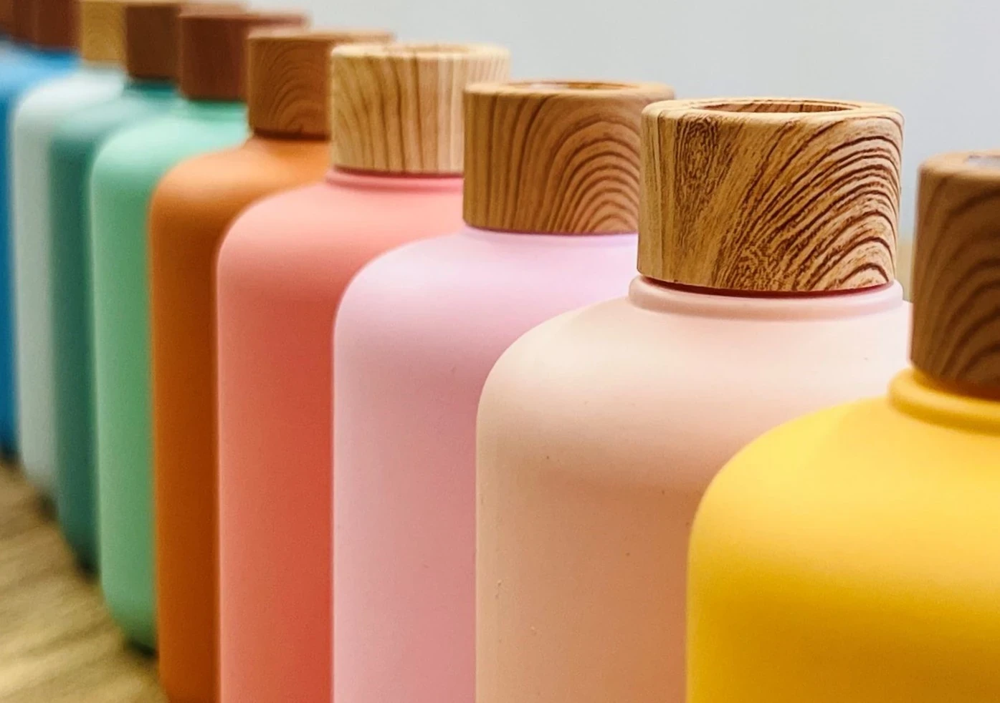
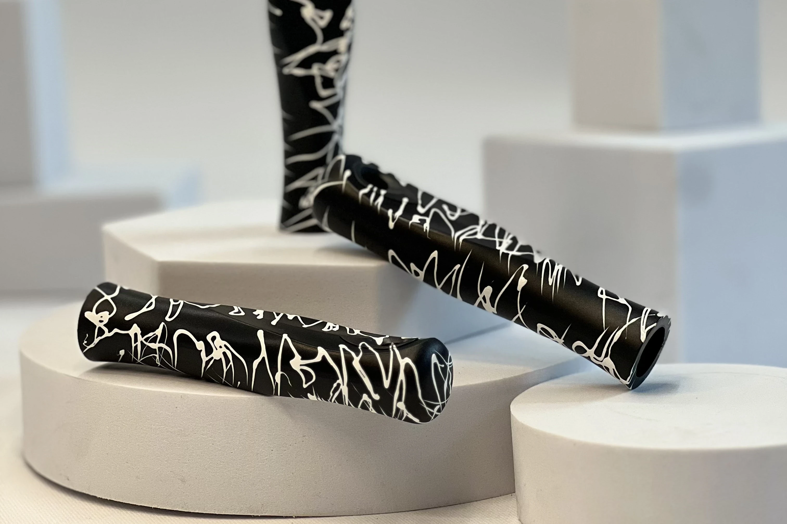
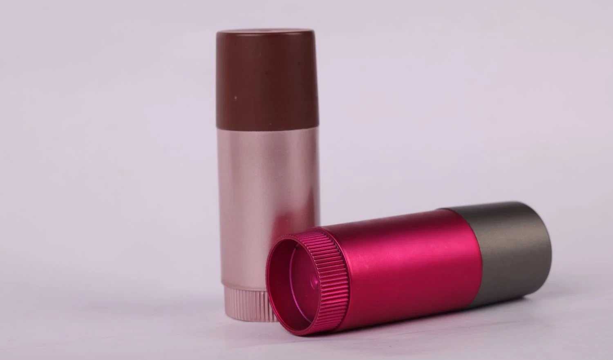
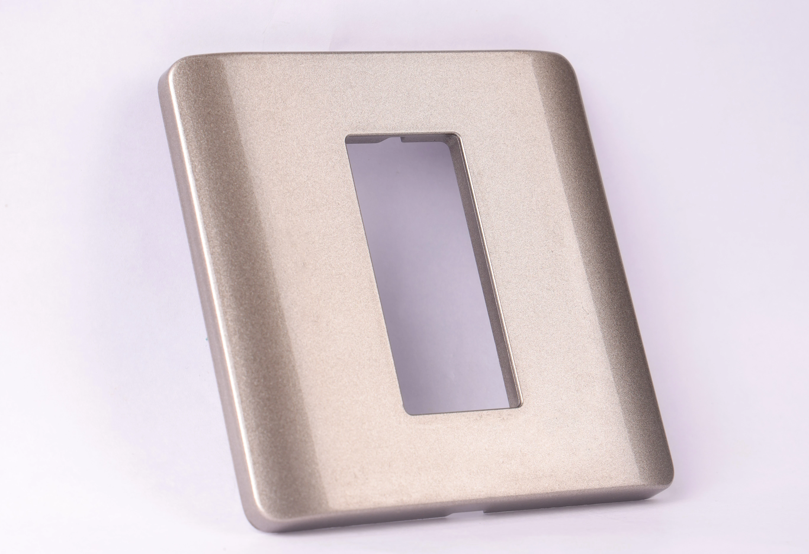
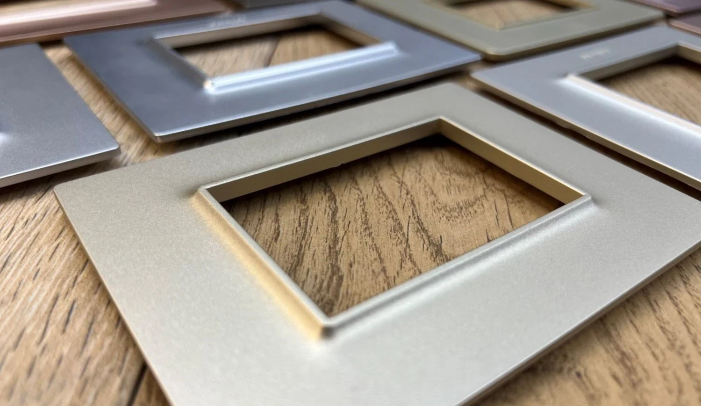
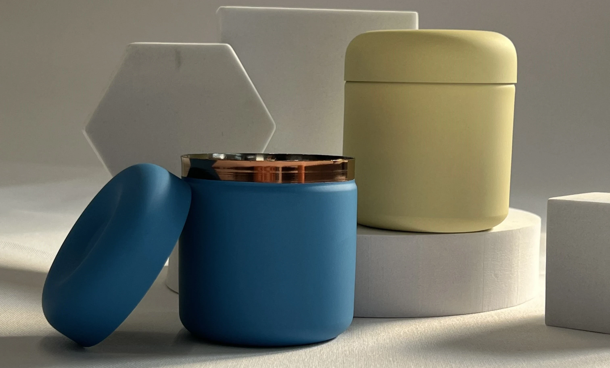

# Best Spray Painting and Hydrographic Printing Service in India

> **Source URL:** [https://paintking.in/best-industrial-spray-painting-company-in-india/](https://paintking.in/best-industrial-spray-painting-company-in-india/)

## High-Resolution Article Media

## Full Article Content

# Best Spray painting & Hydrographic printing service in India | Best way to differentiate your product from competition & increase sales

### Add character to products with spray painting and hydro-dipping services.

In today's fast growing landscape, it is imperative to offer a product that is not only functional but also visually appealing. Brands are increasing investing in services that elevate the visual appeal of their product, either through physical attributes, packaging or both. 

Spray Painting & Hydrographic printing is a versatile and popular option for most brands to add a bit of colour and character to their range of items. From electrical appliances such as electrical switch boards, hair dryers, juicers to Kids toys, spray painting ensures an even and smooth finish on items.

## What is Spray Painting?

Spray painting is a technique where a paint is sprayed onto a surface using compressed air with the help of a spray gun machine. This method allows for a quick and even application of the coating compared to traditional brush painting.

## Benefits of Spray Painting over Other Methods

Time Saving: Spray painting reduces the painting as compared to our transition brush or roller painting methods. With the help of automated conveyor belts, PaintKing team is able to process and spray paint on products in large quantities.

Uniform Finish: Spray painting provides a smooth, consistent finish that is difficult to achieve with other methods. The end result ensures a dust free and professional look with flawless results.

Durability: The controlled application of paint with spray painting ensures a strong bond with the surface, leading to increased durability. 

Cost-Effectiveness: When produced in bulk quantities, this method is extremely cost-effective and ensure minimum rejection.

Versatility: Spray painting can be painted to a wide range of materials, shapes, and sizes, making it a highly versatile solution.

## Industrial spray painting process at PaintKing:

Surface Preparation: Surface preparation is an important process to the success of the painting process. This is a process completed by cleaning and sanding processes done by the team at paintking to ensure there is proper adhesion of the paints and that a smooth finish is achieved. 

Masking: Proper masking helps in protecting surrounding areas from overspray. For guarantees on neat lines and professional results. This process ensures that the paint does not spray at unwanted areas of the product. 

Paint Colour Selection: Usually our client provides us with their desidered paint which they want to paint on their product. We use that paint. If they don't have the paint then making the right decision about which colour to use is very important so it’s worth remembering here that one should be wise. Paintking has vast knowledge concerning different kinds of paint used by industry. Our competent staff members assess several issues including the material used on the surface, the environment around and how one may want it finished before they come up with the perfect choice for your job. 

Spray Painting: Paintking has highly-skilled workers who make sure that coats are evenly sprayed on surfaces using spraying equipment for this purpose. They ensure uniform coverage and minimal wastage. And send the product to the drying process.

Cleanup: After the painting process our staff start cleaning the product pieces. We clean with great care so that your product can be spotlessly clean before moving onto the next step.

Quality Control: With the help of advanced technology such as the spectrophotometer, PaintKing ensures the colour accuracy of the painted surface. Paintking’s Quality control team regularly conducts several tests on material before dispatch to ensure every batch is meticulously crafted. 

Pack & Dispatch: Paintking’s team starts packing the sample. Once everything is done, we initiate the dispatch process.

### Download Our Product E-Calalogue: Download 

## Why Choose Paintking for Your Spray Painting Needs?

### Experience and Expertise

PaintKing, with over 30 years of industry expertise, Paintking is excellent in providing spray painting, hydrographic printing, digital printing, and injection moulding. Their innovative techniques and commitment to quality ensure exceptional finishes and transformative solutions for various products.

### Comprehensive Services

PaintKing offers top-notch spray painting, hydrographic printing, digital printing, and injection moulding services. With over 30 years of experience, they deliver exceptional finishes and innovative solutions. Their expertise guarantees high-quality, precise, and creative results, making them a trusted partner for upgrading product aesthetics.

### Commitment to Quality

PaintKing is well known for its commitment to quality service. Every product undergoes strict quality checks to ensure an unmarked finish. Their advanced techniques in spray painting, hydrographic printing, digital printing, and injection moulding guarantee accuracy and durability. With over 30 years of experience, PaintKing consistently delivers top-notch results, making them a trusted partner for businesses seeking top-notch services. 

### Customer Satisfaction

PaintKing places a high priority on customer satisfaction. They aim to give best to their client expectations through outstanding service and quality. By maintaining open communication, understanding client needs and delivering on promises, PaintKing ensures a good experience. Their commitment to accuracy, creativity, and reliability has earned them a loyal customer base and a reputation for excellence.

Choosing the right industrial spray painting company is critical for ensuring the longevity, functionality, and aesthetics of your assets. At Paintking, we understand the importance of quality and expertise. We offer a comprehensive range of services, utilise only the best materials, and prioritise safety throughout the process.

Contact Paintking today for a free consultation and quote.

* Home

* Our ServicesMenu Toggle

 All Services
 <a href=
