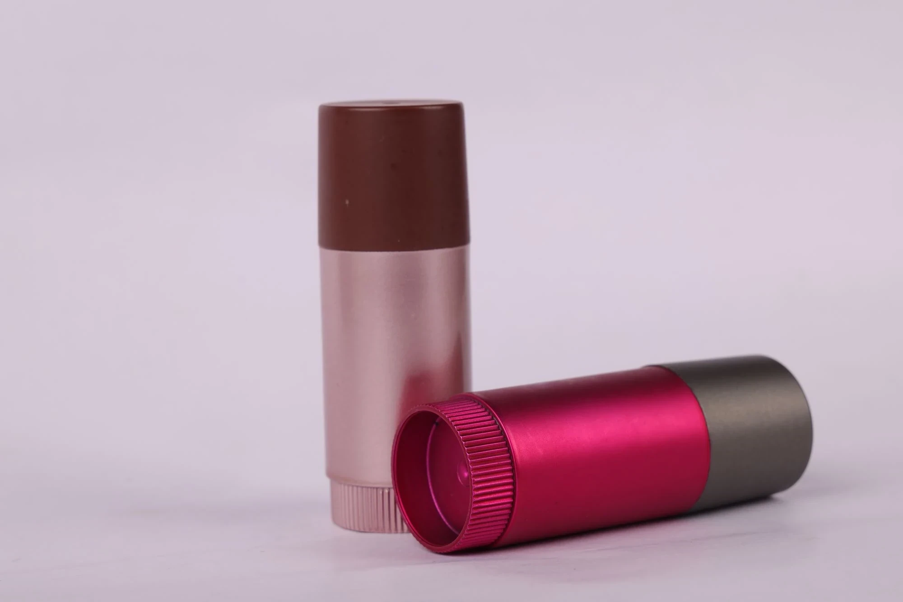

# Best Spray Painting Company

> **Source URL:** [https://paintking.in/best-spray-painting-company/](https://paintking.in/best-spray-painting-company/)

## High-Resolution Article Media

## Full Article Content

# Best spray painting company

For more than thirty years now, Paintking has been one of the most experienced industries known in India. We specialize in paint spraying; hydrographic printing; and digital printing for different customers within the fields of automotive manufacturing, and also producing consumer goods. This is why we have become an ideal partner for any company that wants superior end products. we provide the best quality at good prices.

Visit our blog page for more blogs: Blog Page

## What is Industrial Spray Painting?

### 1. Experience and Expertise

Having been in the market for more than three decades, Paintking has a unit of well learned and certified technicians. They are experienced across different sectors and job descriptions digitally and physically geared towards delivering your project flawlessly.

### 2. Uncompromising Quality

We are committed to delivering excellence. Our state-of-the-art machinery, coupled with stringent quality control measures and premium paints, ensures that your end product surpasses expectations and stands the test of time.

### 3. Massive Services Range

Paintking offers a comprehensive suite of services to meet your diverse needs. From the intricate artistry of spray painting and hydrographic printing to the precision of digital printing and the durability of injection molding, we provide end-to-end solutions for individuals and businesses alike.

### 4. Customer Centric Approach

Building lasting relationships is our priority. We prioritize understanding your specific requirements, providing expert guidance, and exceeding your expectations. Our dedication to exceptional service is evident in the numerous testimonials from satisfied clients who return for repeat business.

* Home

* Our ServicesMenu Toggle

 All Services

* Hydrographic Printing Services

* Spray Painting Services

* Digital Printing Services

* Gallery

* Blog

* About Us

* Contact Us

* About Us page
* Blog
* Careers
* Contact Us
* Digital Printing Services
* Gallery Page
* Home Page
* Hydrographic Printing Services
* New Services Page Structure for Paintking
* Our Services Page
* Spray Painting Services

## Quick Links

Home

About Us

Our Services

Gallery

Contact Us

Blog

## PaintKing Head Office

37/A,1st floor, Charkop Industrial Estate, Kandivali West, Mumbai, Maharashtra 400067.

## PaintKing Haridwar Unit

Plot No. 150, Integrated Industrial Estate, Sector IIDC, SIDCUL, Haridwar, Uttarakhand 249403.

## Contact Us

 <div class="elementor-element elementor-element-84345e9 elementor-mobile-align-center elementor-icon-list--layout-traditional elementor-list-item-link-full_width exad-sticky-section-no exad-glass-effect-no elementor-widget elementor-widget-icon-list" data-id="84345e9" data-element_type="widget" data-widget_type=
