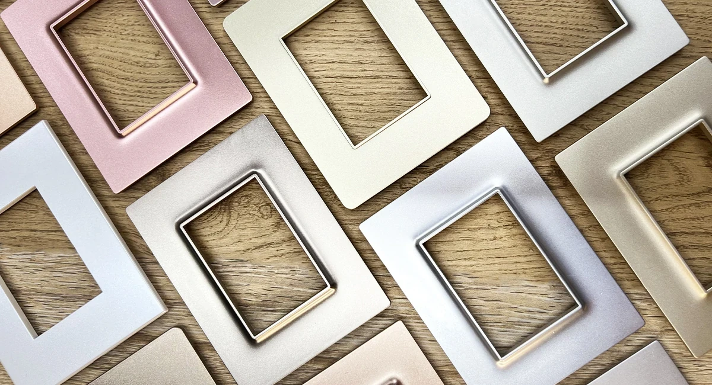
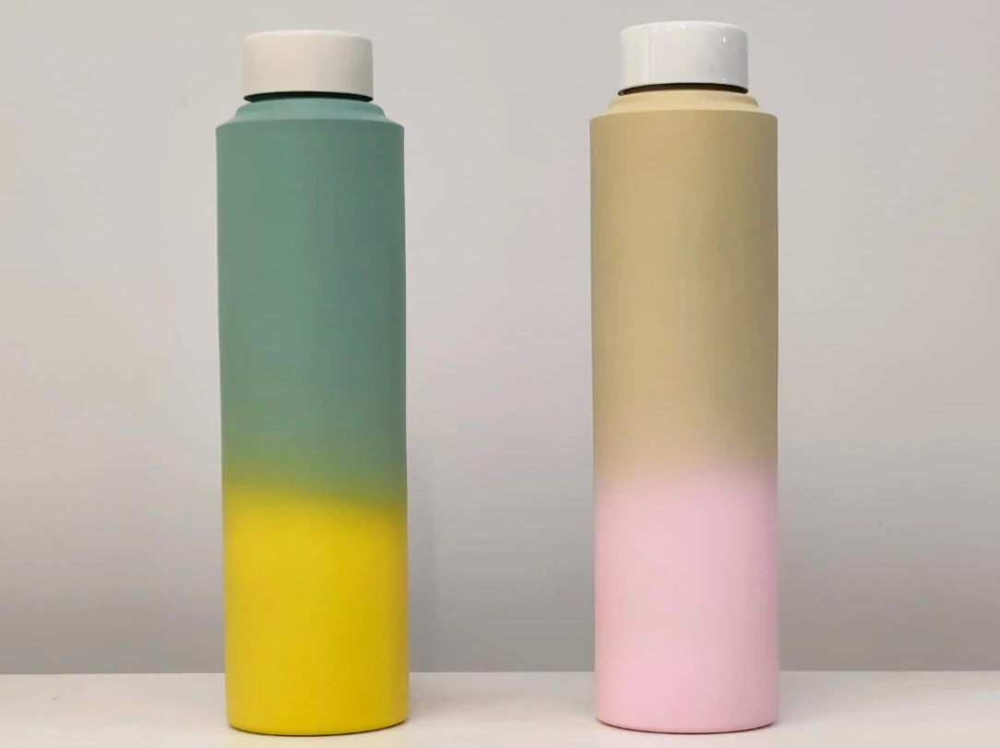
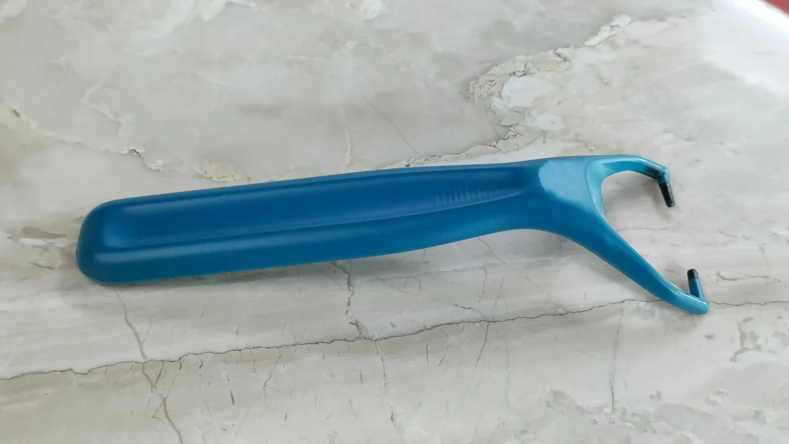
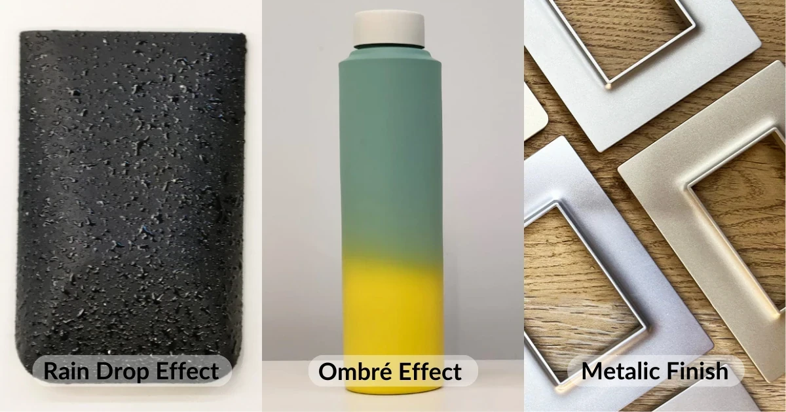
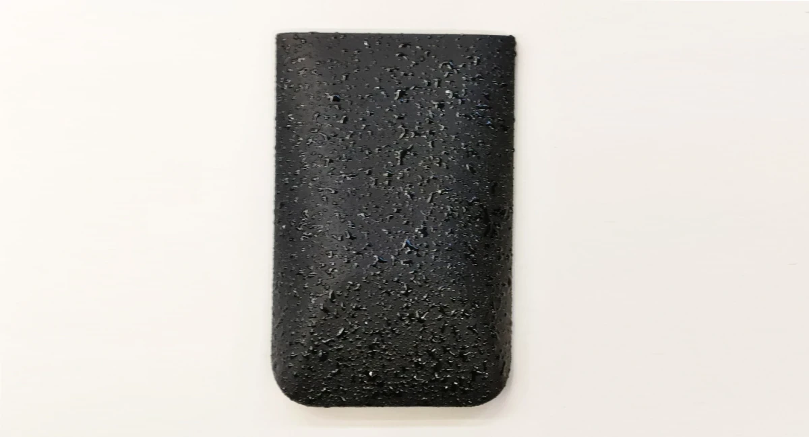
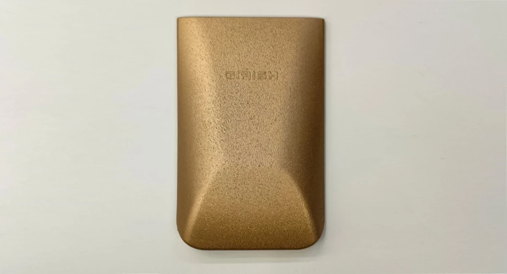

# Best Spray Painting Finishes for Plastic and Steel Products

> **Source URL:** [https://paintking.in/paintking-spray-painting-finishes/](https://paintking.in/paintking-spray-painting-finishes/)

## High-Resolution Article Media

## Full Article Content

# Best spray painting finishes for plastic & steel products | Types of spray painting & PU coating near me

Spray painting also known as industrial spray painting is a very popular and cost effective way to transform products. Brands rely heavily on spray painting to transform boring plastic molding into premium works of art. Paintking offers a range of spray painting finishes on various materialsas well as Hydrographic printing (also known as water transfer printing or hydrodipping), Digital Printing solutions to elevate the aesthetics of your product.. 

Types of spray painting finishes:

## 1. Soft Rubber Feel

Soft rubber feel spray painting finish provides a unique smooth experience. It makes the painted surfaces into a rubbery texture. This innovative paint creates a durable and flexible coating that enhances grip and adds a unique modern look to the painted surface. This finish is ideal for any product handels, tools, electronics, mobile covers, and etc. with comfort of a non-slip surface. It makes the product look like silicone and helps achieve the desired finish that matches the brand guidelines.

Explore more finishes with the help of our product e-catalogue: Download Our Product E-Catalogue. 

### 2. Ombré Effect or Two tone colour effect

The ombré painting effect is a finish that creates a gradient of colours, the colour starts with one colour shade and transitions to another colour. Ombré colours are a great way to add a hint of 2-3 tones with a smooth transition between the two colours. This effect can be clubbed with other methods of painting and printing to add a more defined look. Most popular applications are on bottles, serveware, plastic partitions, hair accessories, electrical switches and kid toys. This look is most popular for hawaiian / ocean themed products since the blend of 2-3 colours via spray painting allows to achieve a seamless yet soothing transition.

### 3. Metallic Finish

Spray painting in metallic finish offers a shiny look to the product. At PaintKing, we specialise in providing high-quality metallic finish painting services that give a rich sheen look. This is a popular option for multiple applications. Metallic paint finish is very popular in a lot of industries. From hair appliances from Dyson to electrical switches from top brands, metallic spray painting is a trendy and classic finish to achieve a premium finish. Additionally, a lot of companies also use this finish on furniture such as consoles, table tops and chairs. 

### 4. Sand Finish

While spray painting and hydrographic is the most popular finish, PaintKing offers some unique finishes that are exclusive. This sand finish is one of the unique spray paintings that transforms any product with the help of this sand like texture. This unique finish is very popular for gifting articles, corporate gifting and decor products. This finish looks spectacular when applied on the right product and helps differentiate the product from competition. 

### 5. Rain Drop Effect

The Rain Drop effect also known as the textured water effect makes any product feel like it was just dipped in water. This finish reflects the light in a way which makes the texture look like water droplets. This finish will look so nice if it is painted on AC Panels, Umbrella Handle, Refrigerator front panels, kids toy water gun. 

For more such finishes, get in touch with the PaintKing team. Contact Us today to discuss your product. 

 Contact Us

* Home

* Our ServicesMenu Toggle

 All Services

* Hydrographic Printing Services

* Spray Painting Services

* Digital Printing Services

* Gallery

* Blog

* About Us

* Contact Us

* About Us page
* Blog
* Careers
* Contact Us
* Digital Printing Services
* Gallery Page
* Home Page
* Hydrographic Printing Services
* New Services Page Structure for Paintking<a href="https://paintking.in/our-services-page/" class="menu-
