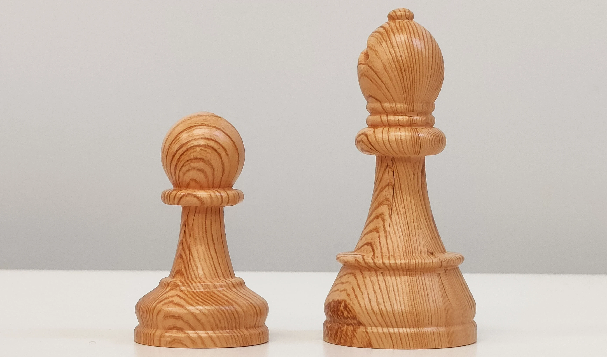
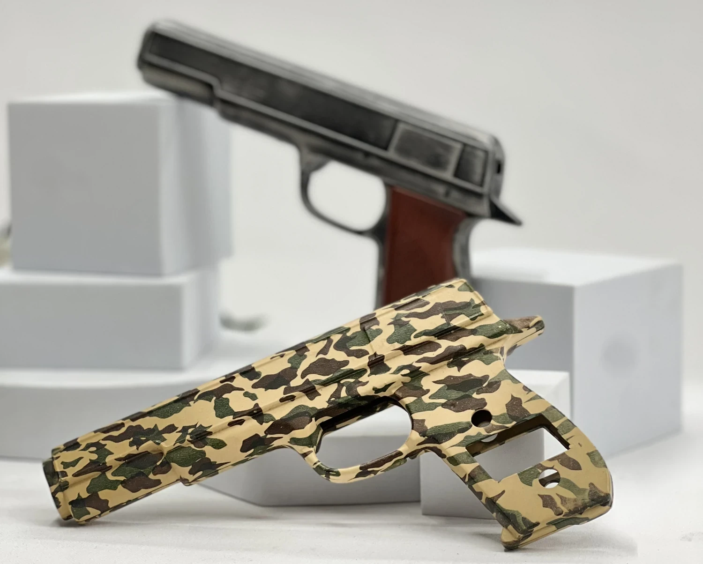
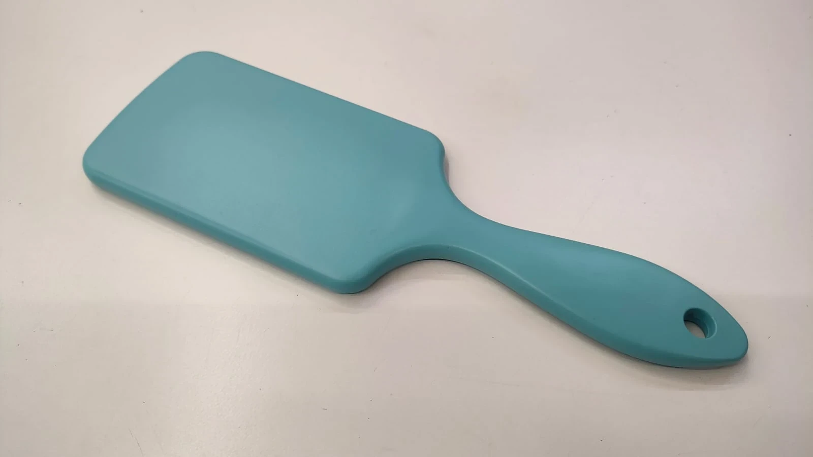
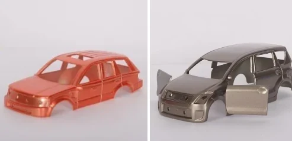
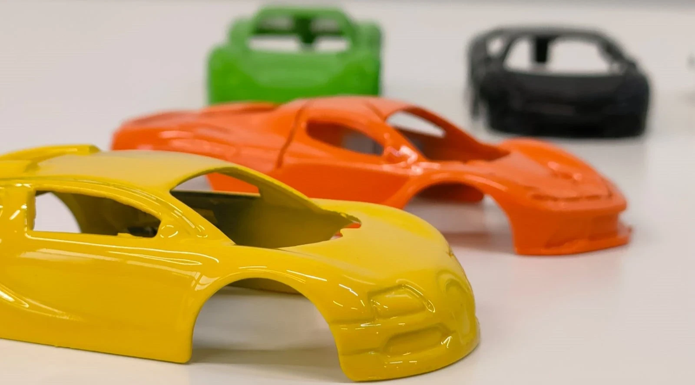
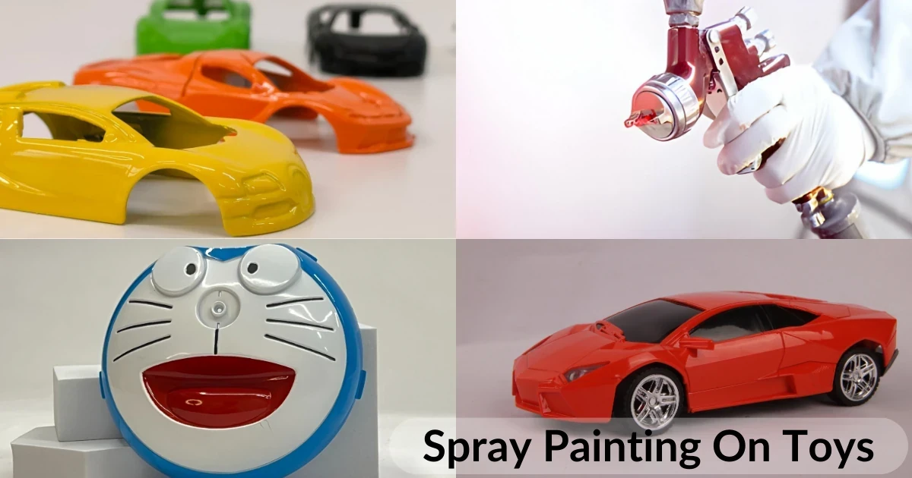

# Best Spray Painting Services on Toys Near Me

> **Source URL:** [https://paintking.in/best-pu-painting-or-spray-painting-on-toys-near-me/](https://paintking.in/best-pu-painting-or-spray-painting-on-toys-near-me/)

## High-Resolution Article Media

## Full Article Content

# Best Spray painting Services on toys near me 

Oftentimes companies invest heavily in the right aesthetics because they understand the impact and importance of reaching the target audience. Kids toys are a great example of this technique used by marketing agencies worldwide. Companies invest millions each year to bring the best visually appealing toys to their clientele. A popularand cost effective solution is opting for spray painting on toys.

## What is spray painting? 

Spray painting is a painting method that uses compressed air for painting, with the help of a spray gun. Paint comes in high pressure from a very small hole. This process helps paint spread evenly on the surface. Compared to painting with a brush or roller, spray painting gives an almost flawless finish with even coverage and uniform finish.

You may also like to read  PaintKing: Spray Painting Finishes

## Why spray painting on toys?

Spray painting helps elevate the look of any material. Spray painting on toys is a very popular method to give a premium finish to the toys. 

### 1. Metal & Plastic toy cars 

Spray painting on small metal cars gives it a premium and uniform coating. It allows the brand to produce different colours and ensure they can offer variety to the end consumer. Brands also prefer to add detailing such as headlights, small handles and other details to make it look like a realistic version of the car. These small details differentiate the quality and feel of a toy and make it more desirable.

### 2. Kids kitchen sets, garage toys and more

For a realistic and premium finish, kids toys such as kitchen sets, garage toys, doctor sets and other fun toys can be adorned with interesting finishes. Wooden finish on kids kitchen sets with the help of hydrographic printing (also known as hydro dipping)  gives the toys a realistic wooden feel without making the toys heavy. Wooden toys are typically heavier and more prone to termites and mould. In addition to wooden finish on plastic toys, spray painting metallic finish on plastic toys is also a fun way to elevate the boring looking toys. Not only is it cost effective, but it also helps to transform the product from competition.

### 3. Kids diwali guns, army toys and more 

During diwali, kids love to play with diwali toys and with the help of spray painting and hydro dipping, we can adorn the toys with fun finishes such as army prints, carbon fibre, rubber finish spray paint and much more.

Download our e-catalogue to explore other finishes 

### 4. Kids accessories with rubber finish 

During the primary stages, as kids start playing with toys to improve their motor skills and hand eye coordination, it is imperative to give toys that help their grip. Rubber finish on toy handles and other small parts can help kids develop their skills faster. Spray painting on hair accessories and brushes is also a very popular option for brands who want to transform the look of their products. 

### 5. Kids wardrobe finishes 

Children's rooms are always bombarded with toys and parents are often looking for aesthetically pleasing storage solutions. While plastic containers are cost effective, they do not necessarily look the most pleasant. At Paint King, we work with a lot of brands and help them give a wooden look to plastic furniture. Not only is it a cost effective way to add some design to furniture, but also helps to differentiate from competition.

Get in touch with us to know more 

Check out our Instagram Page for more insights and behind the scenes work

Check out our  Instagram Page for more insights and behind the scenes work

## How to Contact Paintking?

* Go to our website at paintking.in
* Click on the contact button which is on the top right corner in the header section.
* Fill the form. You will receive email confirmation of email submission.
* If you don’t receive any email please recheck your email when you are filling the contact us page form. Make sure that the Email field contains your right email.
* Our team will contact you as soon as possible.

At Paintking we pride ourselves as the pioneers when it comes to spray painting on plastic and wooden products, especially when it comes to kids toys. Since the past 30+ years, our co-founder has been working with some of the industry experts and bringing smiles to kids faces with the help of cheerful and colourful toys. 

Sometimes all you need is a bit of colour to elevate the look and feel of any product. 

In case you have a similar product and want to explore spray painting or other coating solutions, get in touch with our team expert. Our team, who has years of experience will guide you. Look no further contact Paintking today.

 Contact Us

 <nav class=
