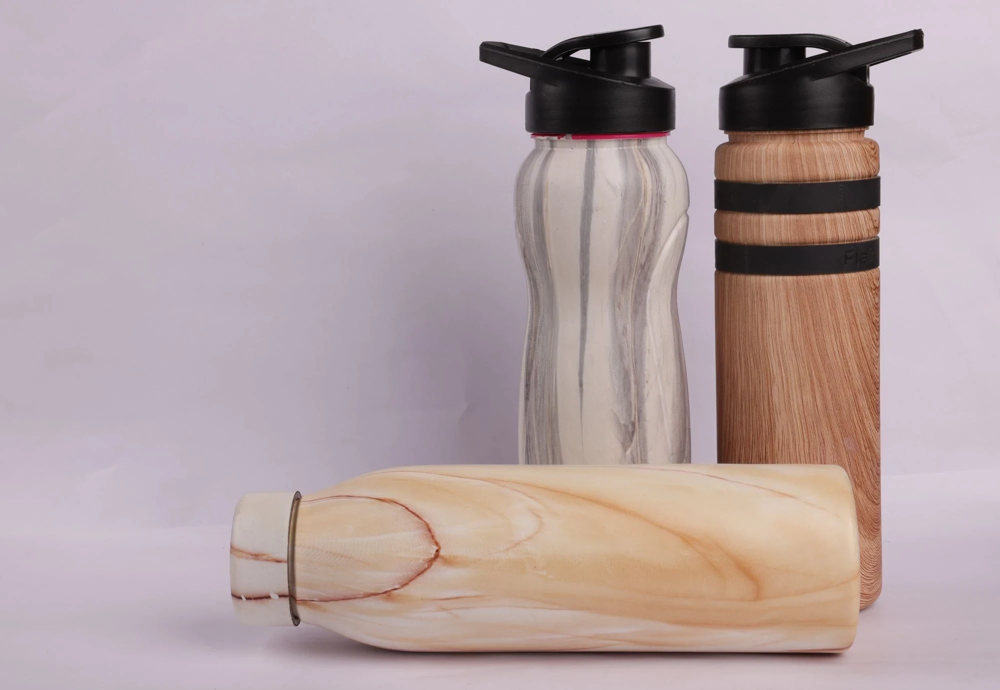

# DIY Hydro Dipping vs Pro Service

> **Source URL:** [https://paintking.in/diy-hydro-dipping-vs-pro-service/](https://paintking.in/diy-hydro-dipping-vs-pro-service/)

## High-Resolution Article Media

## Full Article Content

# DIY Hydro Dipping vs. Pro Service

Hydro dipping is a popular DIY project now. There are pros and cons of taking it up as a DIY project versus letting a professional do it. We at Paintking propose to adopt both methods based on what you want to achieve.

## The DIY Route

### Pros:

Cost-Effective: DIY kits are significantly cheaper than professional services.

Creative Control: You choose the film design, activator, and base coat, allowing for complete customization.

Sense of Accomplishment: There's a satisfying feeling in completing a project yourself.

Learning Experience: The process itself teaches valuable skills about surface preparation and working with activator solutions.

### Cons:

Learning Curve: Hydro dipping requires practice to achieve professional-looking results. Uneven application, missed spots, or improper rinsing can lead to imperfections.

Limited Design Options: DIY kits usually offer a smaller selection of film designs compared to professional services.

Safety Concerns: Activator solutions can be harsh and require proper ventilation and safety gear.

Equipment Investment: Purchasing a hydro dipping kit, activator, film, base coat, and other supplies can add up.

## The Professional Service

### Pros:

Guaranteed Quality: Professionals have the experience and equipment to deliver flawless finishes with even coverage and vibrant colours.

Wider Design Selection: Professional services offer a vast array of film designs, catering to various styles and preferences.

Durability: Professionals use high-quality materials and proper techniques, ensuring a longer-lasting, chip-resistant finish.

Safety and Convenience: Professionals handle the activator and have proper ventilation systems, eliminating safety concerns for you.

### Cons:

Cost: Professional services are more expensive than DIY kits.

Less Control: You may have less control over the specific film option or base coat used.

## The Paintking Verdict: Finding the Right Fit

Here at Paintking, we believe in empowering you with the right tools and knowledge.

For the Cost-Conscious DIYer: If you're comfortable with a little trial and error and are looking for a budget-friendly option, DIY hydro dipping can be a rewarding experience. Just be prepared to invest some time in learning the technique.

For the Perfectionist: If achieving a flawless, professional-looking finish is paramount, and you value convenience and a wider range of design options, then a professional hydro dipping service is the way to go.

No matter which route you choose, Paintking can help! We offer a variety of hydro dipping film designs to fuel your creativity, and we partner with experienced hydro dipping professionals to deliver top-notch results.

Contact us today to discuss your project and find the perfect hydro dipping solution to transform your ordinary objects into extraordinary works of art!

* Home

* Our ServicesMenu Toggle

 All Services

* Hydrographic Printing Services

* Spray Painting Services

* Digital Printing Services

* Gallery

* Blog

* About Us

* Contact Us

* About Us page
* Blog
* Careers
* Contact Us
* Digital Printing Services
* Gallery Page
* Home Page
* Hydrographic Printing Services
* New Services Page Structure for Paintking
* Our Services Page
* Spray Painting Services

## Quick Links

Home

About Us

Our Services

Gallery

Contact Us

Blog

## PaintKing Head Office

37/A,1st floor, Charkop Industrial Estate, Kandivali West, Mumbai, Maharashtra 400067.

## PaintKing Haridwar Unit

Plot No. 150, Integrated Industrial Estate, Sector IIDC, SIDCUL, Haridwar, Uttarakhand 249403.

## Contact Us

* 

 +91 9594591313

* 

 info@paintking.in

## Stay Connected

 <div class="elementor-element elementor-element-303d2f0 e-grid-align-left
