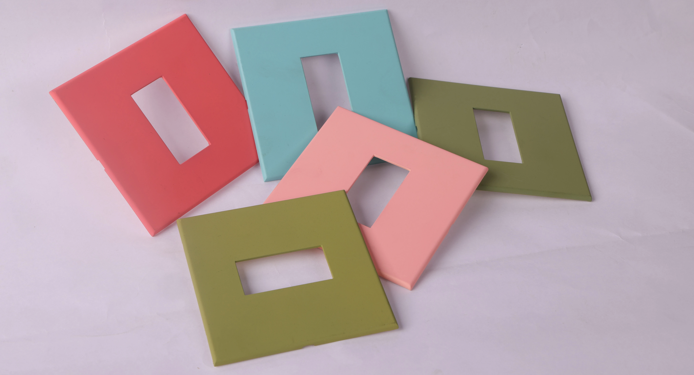

# Ensuring Flawless Finishes - Quality Control with Spectrophotometer

> **Source URL:** [https://paintking.in/ensuring-flawless-finishes-quality-control-with-spectrophotometer/](https://paintking.in/ensuring-flawless-finishes-quality-control-with-spectrophotometer/)

## High-Resolution Article Media

## Full Article Content

# Ensuring Flawless Finishes: Quality Control with Spectrophotometer

With Paintking, a perfect coat is more than mere beauty; it also means that your project will last longer and function better when completed hence we strive to achieve this equilibrium. This is why we are ensuring top-notch quality control measures such as the use of spectrophotometers which help us to maintain uniform and superior results in all spray painting work undertaken at our firm.

## What is Spectrophotometer?

A spectrophotometer is a tool that measures the color of a painted surface. It helps to ensure that the color is exactly right by comparing it to a standard. This is important for quality control because it makes sure all the painted parts look the same.

## Why is Quality Control Important in Spray Painting?

Paint isn't merely colouring, but an artful mixture of substances scientifically combined to bring about specified outcomes. In circumstances where large-scale and industrial painting jobs have to take place, these are some of the issues that arise from the quality of painting done:

Durability: A high-quality paint job should withstand wear and tear, harsh environments, and extended periods of time.

Colour Consistency: Matching a specific colour scheme is crucial for aesthetics and brand consistency. Even minor variations can be visually jarring.

Performance: Certain paints offer specific properties, like adhesion, chemical resistance, or UV protection. Ensuring these properties meet expectations is vital.

## Spectrophotometer: An Important Machine in Quality Control

The performance of the human eye is outstanding but it has some drawbacks when it comes to precise colour and finish measurements. This is the function of spectrophotometers which act as a digital eye and take different measurements of paint finishes.

### How Spectrophotometers Work

* Light Measurement: The spectrophotometer emits a precisely controlled beam of light onto the painted surface.
* Colour Analysis: The instrument then measures the wavelengths of light that are reflected back from the surface.
* Data Collection: This data is collected and analysed, providing a precise numerical representation of the colour and finish of the painted surface.

## Benefits of Using Spectrophotometers for Paint Quality Control:

* Objective Measurements: Spectrophotometers eliminate subjectivity from the quality control process. Numbers don't lie, ensuring consistent and accurate colour matching every time.
* Repeatability: These instruments allow us to replicate measurements precisely. This is crucial for ensuring consistency throughout a large project or across multiple batches of paint.
* Data Tracking: The data collected by the spectrophotometer can be stored and compared over time. This allows us to monitor trends and identify any potential issues before they impact the project.
* Advanced Analysis: Modern spectrophotometers offer additional functionalities, like gloss measurement and surface texture analysis. This provides even more comprehensive insights into the overall quality of the paint finish.

## Paintking's Quality Control : Beyond the Spectrophotometer

While spectrophotometers are a powerful tool, they are just one part of our comprehensive quality control process. Here's a glimpse into our commitment to excellence:

* Meticulous Surface Preparation: A flawless finish starts with a perfect canvas. We meticulously prepare surfaces before painting, ensuring optimal paint adhesion and a smooth base.
* Premium Paint Selection: We only use high-grade paints from reputable manufacturers, ensuring superior performance and durability.
* Rigorous Process Control: Every step of the spray painting process is monitored and controlled, ensuring consistency and adherence to the highest standards.
* Quality Control Throughout: Our team conducts regular inspections throughout the project, utilising not only spectrophotometers but also visual assessments and touch tests.

Every project is assured of outstanding results at Paintking by combining the accuracy of spectrophotometers with our expertise and commitment to quality control. Our aim is to go beyond your expectations by delivering an error-free spray painted finish that lasts for a long time. 

To know about our quality control methods and project objectives assistance, talk to us today at Paintking.

* Home

* Our ServicesMenu Toggle

 All Services

* Hydrographic Printing Services

* Spray Painting Services

* Digital Printing Services

* Gallery

* Blog

* About Us

* Contact Us

* About Us page
* Blog
* Careers
* Contact Us
* Digital Printing Services
* Gallery Page
* Home Page
* Hydrographic Printing Services
* New Services Page Structure for Paintking
* Our Services Page
* Spray Painting Services

## Quick Links

Home

About Us

Our Services

Gallery

Contact Us

Blog

 PaintKing Head Office
