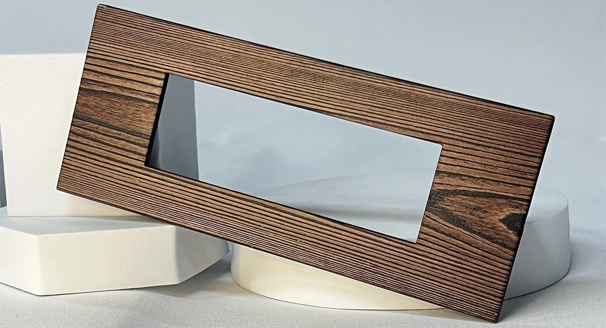
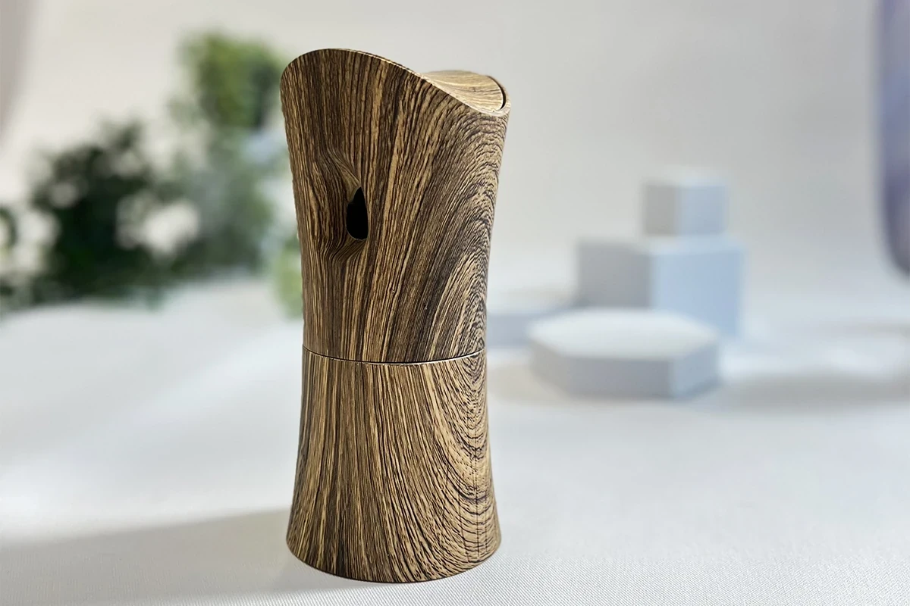
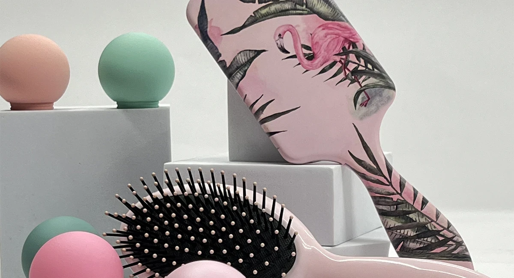
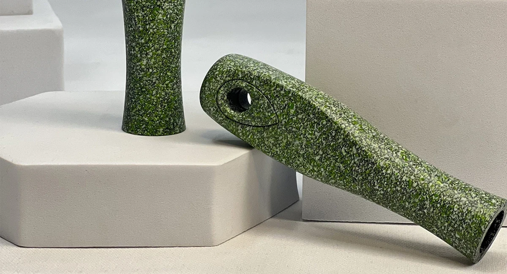
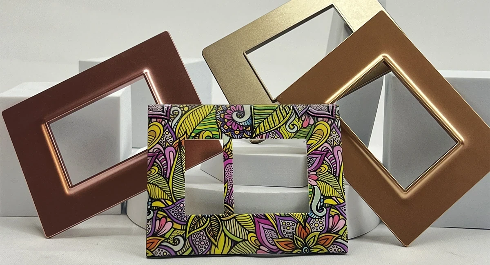

# Why choosing the best partners for spray painting can make a difference

> **Source URL:** [https://paintking.in/why-choosing-the-best-partners-for-spray-painting-can-make-a-difference-best-spray-painting-hydrographic-company-in-india/](https://paintking.in/why-choosing-the-best-partners-for-spray-painting-can-make-a-difference-best-spray-painting-hydrographic-company-in-india/)

## High-Resolution Article Media

## Full Article Content

# Why choosing the best partners for spray painting can make a difference? | Best spray painting & Hydrographic company in India

### PaintKing is known as a pioneer in the coatings and hydrographic printing industry as a reliable partner

In today's competitive landscape, numerous brands have adopted plastic and steel products, making differentiation a significant challenge. Therefore, it is essential to ensure that your product not only meets functional requirements but also possesses a visually appealing design with the help of spray painting, hydrographic printing and UV digital printing.

At PaintKing, we take pride in our status as industry pioneers in the coating sector, recognizing the necessity of transforming any product to enhance its market presence. Selecting the right partners is critical to achieving sustainable results that resonate with consumers.

While many companies provide spray painting and hydrographic printing services, PaintKing uniquely combines a design-centric approach with a skilled workforce, offering a diverse array of finishes that set us apart in the marketplace.

## Why Choose PaintKing?

### 1. Stand Out Of Crowd

At PaintKing (PK), we leverage over 35 years of industry expertise to deliver exceptional coating solutions that meet the evolving needs of our clients. Our board comprises industry leaders and subject matter experts, ensuring that we remain at the forefront of innovation and quality within the coating sector.

Our dedicated design team collaborates closely with clients to recommend optimal finishes that not only enhance product aesthetics but also elevate brand identity. Furthermore, our in-house R&D team works seamlessly with your Industrial Design (ID) team, translating visionary concepts into tangible realities. 

We pride ourselves on our out-of-the-box thinking, fostering a culture of creativity that drives breathtaking results. This strategic approach guarantees that our clients receive tailored solutions that are both functional and visually stunning, setting them apart in a crowded marketplace. By choosing PaintKing, you partner with an organisation committed to excellence, innovation, and the successful realisation of your unique product vision. Together, we can redefine industry standards and ensure your product achieves its full potential.

If you are interested in knowing more about the possible finishes that Paintking offers, you can read our latest blog

### 2. Top notch quality

At PaintKing (PK), we implement rigorous quality control protocols for every product that departs our facility. Our spray-painted and hydrographic coatings deliver a seamless, premium finish, even in bulk quantities. We are committed to upholding the highest standards of quality, utilising comprehensive testing methodologies, including cross-hatch adhesion tests, tape tests, bend tests, and spectrometer analysis.

In an industry where many companies face challenges in maintaining quality during high-volume production, PK stands out as a beacon of consistency and reliability. Our extensive experience allows us to deliver exceptional results that meet or exceed client expectations time and time again.

Our spray-painted and hydrographic printed surfaces have become benchmarks within the industry, setting standards for excellence and performance. We take pride in our ability to provide high-quality solutions that not only fulfil client requirements but also elevate their brand reputation. By choosing PaintKing, you are partnering with a leader dedicated to innovation and quality assurance, ensuring that your products achieve unparalleled excellence in both appearance and durability. Experience the PK difference today, where quality and consistency are our top priorities.

### 3. Massive production

PaintKing boasts an impressive production capacity and a highly skilled workforce, ensuring that every spray painted product exudes flawless quality, even when produced in large quantities. With the ability to handle high-volume spray painting projects, PaintKing's expansive facilities in four different areas across India. Paintking is available in Mumbai, Haridwar, Vapi and Vasai. allow for efficient and seamless operations. The team at PaintKing is extensively trained in delivering massive production, backed by years of experience in handling bulk quantities. Clients can trust PaintKing to surpass their expectations, providing impeccable results for all their spray painting needs. PaintKing stands as a reliable partner in delivering superior quality and efficient production, regardless of the project's size.

You may also enjoy reading our blog about spray painting on toys 

### 4. Latest technology

Paintking is a leader in providing innovative coating solutions. Our expertise lies in four key technologies: spray painting, hydrographic printing, digital printing, and injection moulding. With our advanced spray painting techniques, we guarantee precision, efficiency, and a superior finish quality that sets us apart. Our hydrographic printing technology offers a cutting-edge process, enabling us to create complex and customised designs with unparalleled versatility. By combining digital printing and injection moulding, we achieve high-quality, mass-produced products with intricate designs. At PaintKing, we are committed to technological advancement, continuously pushing boundaries to deliver exceptional results. Explore these technologies further and discover the endless possibilities they offer. Trust PaintKing to be your partner in coating solutions, revolutionising industries one project at a time.

If you're a business owner looking for some of our services, please don’t hesitate to contact Paintking.

 Contact Us

* Home

* Our ServicesMenu Toggle

 All Services

* Hydrographic Printing Services

* Spray Painting Services

* Digital Printing Services

* Gallery
Blo
